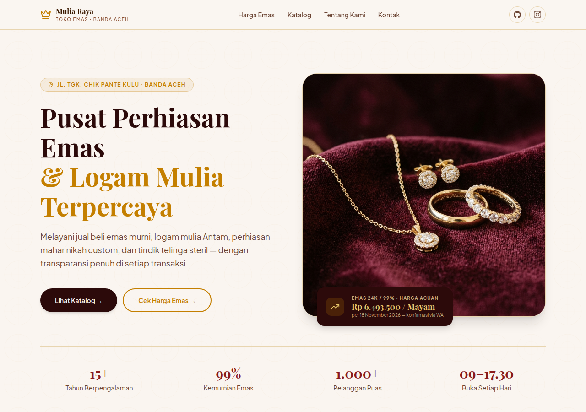

# Shopemas — Toko Emas Mulia Raya (Banda Aceh)

Showroom digital & katalog perhiasan **Toko Emas Mulia Raya** (Jl. Tgk. Chik Pante Kulu No. 58, Pasar Aceh, Banda Aceh): harga emas acuan per mayam, kalkulator estimasi, katalog 18 produk, layanan, testimoni, FAQ, dan kontak — semua tombol diarahkan ke WhatsApp admin.

- **Live:** https://shopemas.pages.dev
- **Repo:** https://github.com/dezzorigin/shopemas
- **Stack:** Next.js 16 (App Router, static export) + React 19 + Tailwind CSS 4 + Framer Motion + lucide-react


*Hero — foto perhiasan di atas beludru marun, chip harga acuan 24K per mayam.*

## Fitur

| Bagian | Isi |
|---|---|
| Hero | Headline, CTA ke katalog & harga, foto produk, chip harga acuan 24K/mayam, statistik toko |
| Harga Emas | Tabel 5 kadar (24K, 23K, 22K, 21K, LM Antam 999.9) per gram & per mayam (1 mayam ≈ 3,33 gram) |
| Kalkulator Estimasi | Pilih kadar + berat (mayam) → estimasi total rupiah, tombol konfirmasi via WhatsApp |
| Katalog | 18 produk, filter Gelang / Cincin / Kalung / Anting / Antam; klik produk → tanya stok via WhatsApp (pesan terisi otomatis) |
| Tentang Kami | Cerita toko + nilai (kejujuran, kepercayaan, kualitas) + tautan WhatsApp / Instagram / lokasi / jam buka |
| Layanan | 6 kartu: emas asli terjamin, timbangan transparan, buyback, mahar custom, tindik steril, konsultasi gratis |
| Testimoni | Ringkasan rating + 3 kartu testimoni (lihat § Batasan) |
| FAQ | 5 pertanyaan umum (akordeon) |
| Kontak | Kartu WhatsApp / lokasi / jam + peta Google Maps + CTA chat |
| Lainnya | Tombol WhatsApp melayang, JSON-LD `JewelryStore`, OpenGraph |

## Video demo

Video demo (tanpa audio — direkam headless): [docs/demo.mp4](docs/demo.mp4) — klik gambar di bawah untuk memutar:

[](docs/demo.mp4)

## Cara jalan

```bash
npm install
npm run dev     # http://localhost:3000
npm run build   # static export ke out/
npm start       # butuh server; untuk preview statis: npx serve out
```

Perintah lain: `npm run typecheck` (tsc), `npm run lint` (eslint), `node scripts/smoke.mjs out` (cek marker di hasil build).

## Cara update harga

Harga **bukan** harga live — tidak ada API harga emas yang dipanggil. Angka di `src/app/page.tsx` (`GOLD_PRICES`) adalah konstanta yang diperbarui manual oleh pengelola toko. Saat mengubahnya, ubah juga tanggalnya:

```ts
const PRICE_AS_OF = "18 November 2026"; // <- tanggal acuan harga
const GOLD_PRICES = [
  { kadar: "Emas 24K / 99%", hargaGram: 1950000, highlight: true },
  // ...
];
```

Situs menampilkan tanggal acuan di hero, tabel harga, dan catatan kaki — pembeli selalu diarahkan konfirmasi harga transaksi via WhatsApp sebelum datang.

## Deploy

Static export (`output: "export"` di `next.config.ts`) → deploy folder `out/` ke Cloudflare Pages (project `shopemas`, https://shopemas.pages.dev). CI GitHub Actions (`.github/workflows/ci.yml`) menjalankan typecheck → lint → build → smoke di setiap push/PR ke `main`.

## Batasan & kejujuran

- **Harga bukan live.** Tabel harga & kalkulator memakai konstanta manual (lihat atas). Tidak ada integrasi Metalprice/GoldAPI — klaim "auto-fetch" di PRD lama sudah dihapus.
- **Testimoni contoh.** Nama & isi testimoni ("Rahmi Saputri" dkk.) adalah contoh ilustratif dari pembangun awal, bukan ulasan terverifikasi. Jangan diklaim sebagai ulasan asli sampai diganti testimoni pelanggan sungguhan.
- **Foto katalog dari Unsplash.** Foto produk di katalog adalah foto stok Unsplash (hotlink), bukan foto produk asli toko — kecuali `public/hero.png` (foto perhiasan) yang dipakai di hero.
- **Peta bukan pin persis toko.** Embed Google Maps mengarah ke area Masjid Raya Baiturrahman (toko berada di kawasan Pasar Aceh, dekat masjid), bukan pin koordinat toko yang terverifikasi.
- **Statistik toko** ("15+ tahun", "1.000+ pelanggan", "5.0 dari 200+ ulasan") berasal dari klaim repo awal dan belum diverifikasi independen.
- **Nomor WhatsApp & alamat** (0812-7993-9946, Jl. Tgk. Chik Pante Kulu, @muliaraya.emas) adalah data toko asli dari repo awal — dipertahankan apa adanya.
- **Video demo tanpa audio** (direkam headless).

## Struktur

```
src/
  app/
    page.tsx        # seluruh halaman (Header, Hero, HargaEmas, Katalog, ...)
    layout.tsx      # font, metadata, OpenGraph, JSON-LD JewelryStore
    globals.css     # Tailwind + font Playfair/Plus Jakarta Sans
  data/
    catalog.ts      # 18 produk katalog (nama, kadar, berat, tag, foto)
scripts/
  smoke.mjs         # cek marker di out/index.html hasil build
docs/
  PRD.md            # PRD jujur (revisi dari PRD lama)
  ARCHITECTURE.md
  CHANGELOG.md
  diagram.html      # diagram arsitektur (HTML+SVG)
  screenshots/      # screenshot tampilan asli
  demo.mp4          # video demo (tanpa audio)
```

## Lisensi

MIT — lihat [LICENSE](LICENSE).
